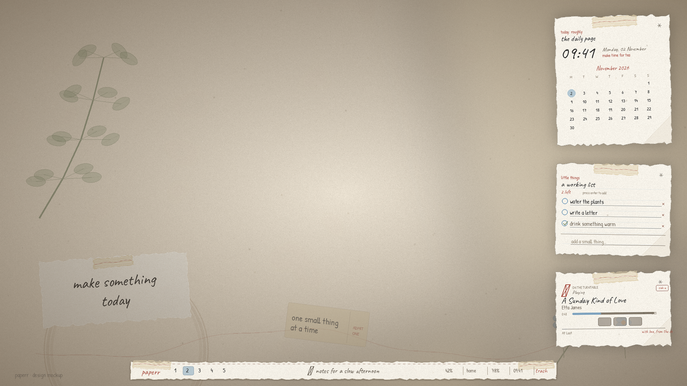
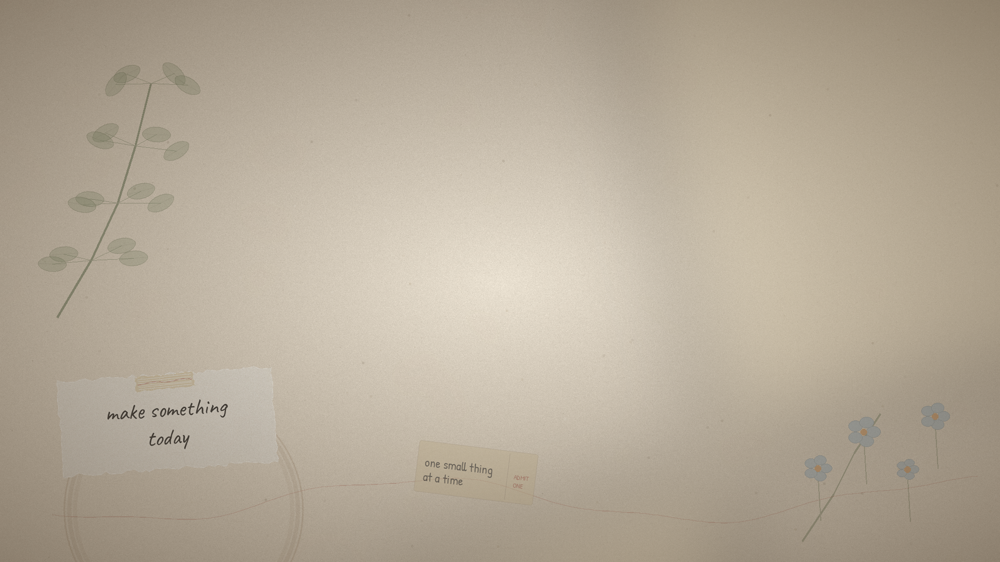
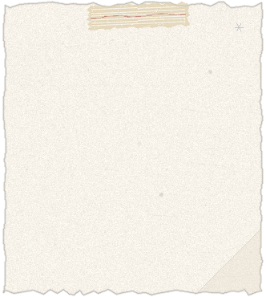
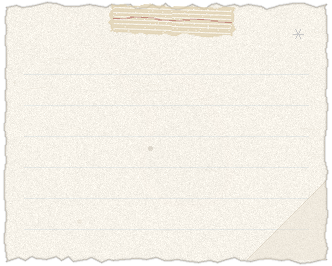
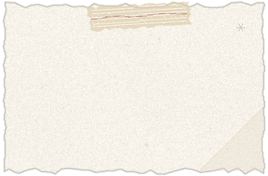

# Paperr

A warm, hand-drawn scrapbook desktop for **Arch Linux + Hyprland**.
Paperr treats every window as a sheet of paper on a quiet desk: torn edges,
washi tape, soft graphite shadows, fountain-pen red, sky-blue accents, and
handwritten type.

> This is a design mockup composed from the actual Paperr textures, cards and
> fonts — not a screenshot of a running compositor.





| The daily page | The working list | On the turntable |
| --- | --- | --- |
|  |  |  |

---

## What you get

- **Hyprland** — thick warm off-white borders, layered-paper shadows, a gentle
  "paper settle" animation, per-app border widths and rounding, and a paper
  wallpaper set with `hyprpaper`.
- **Waybar** — a floating torn strip at the bottom centre, with workspaces,
  the focused window title, tray, volume, network, battery, clock, and a trash
  button on the far right.
- **Kitty** — a real paper-texture background, warm ink, thick padding,
  pastel ANSI colours, a fountain-pen cursor, and a `ctrl+shift+F5` neofetch
  tab with hand-drawn ASCII art.
- **Eww** — three taped scraps on the right: a calendar/clock page, a working
  to-do list backed by plain JSON, and a now-playing card driven by MPRIS.
- **GTK 3 / GTK 4** — an off-white paper theme with a thick, slightly uneven
  inner edge that echoes the compositor border.
- **Extras** — a paper-styled `wofi` launcher, custom fonts, and all generated
  textures/wallpaper (reproducible with `tools/make_assets.py`).

---

## Quick start

```bash
cd ~/Paperr
chmod +x setup.sh
./setup.sh
```

The installer will:

1. back up any existing `~/.config/{hypr,waybar,kitty,eww,gtk-3.0,gtk-4.0,neofetch,wofi}` to
   `~/.config/paperr-backup-YYYYmmdd-HHMMSS`;
2. install the packages with `pacman` (and bootstrap `yay` if needed for
   `eww` + `neofetch`);
3. install the bundled **Caveat** and **Patrick Hand** fonts into
   `~/.local/share/fonts/paperr`;
4. copy every Paperr config and texture into place;
5. validate the Waybar JSON, shell scripts, and Hyprland config.

Then **log out and choose Hyprland**, or apply it to the running session:

```bash
./setup.sh --apply
```

`--apply` is intentionally separate: it restarts Waybar, hyprpaper, and Eww,
which is disruptive if you are in the middle of something.

### Useful flags

| Flag | Meaning |
| --- | --- |
| `--yes`, `-y` | accept defaults; no confirmation prompt |
| `--no-packages` | only install configs/fonts (packages already present) |
| `--with-apps` | also install `nautilus` and `firefox` |
| `--skip-fonts` | do not touch `~/.local/share/fonts` |
| `--apply` | restart the Paperr components in the current Hyprland session |
| `--lua` | install `hyprland.lua` instead of the default classic `hyprland.conf` |
| `--help` | show the short usage text |

### After installing

```bash
# If you did not pass --apply, start the widgets manually:
~/.config/eww/scripts/start-widgets.sh

# Toggle all three scraps:
~/.config/eww/scripts/toggle-widgets.sh

# Look at the widgets from the terminal:
eww logs
```

---

## Screenshot tour

**The bottom bar** is a single 1200 × 58 torn-paper texture with a baked-in
shadow, washi tabs at each end, and a stitched top edge:


**The terminal** uses a tiled paper texture so the grain does not look like a
flat colour. Padding is generous (`22 28 22 28`) and split borders use the same
paper palette. Start `neofetch` to see the hand-drawn sheet; `ctrl+shift+F5`
opens it in a new tab.

---

## Handy keys

| Key | Action |
| --- | --- |
| `SUPER + Return` | kitty |
| `SUPER + Space` | wofi launcher |
| `SUPER + E` | Nautilus (if installed) |
| `SUPER + B` | Firefox (if installed) |
| `SUPER + Q` | close window |
| `SUPER + Escape` | hide / show the three Eww scraps |
| `SUPER + Shift + S` | screenshot a region to `~/Pictures` |
| `SUPER + Print` | screenshot a region to clipboard |
| `SUPER + 1…0` | switch workspace |
| `SUPER + Shift + 1…0` | move window to workspace |
| `SUPER + arrows` / `H J K L` | focus |
| `SUPER + Shift + arrows` | move window |
| `SUPER + V` | toggle floating |
| `SUPER + F` | fullscreen |
| `SUPER + Alt + J` | toggle split |
| `SUPER + Alt + L` | lock the session |
| `SUPER + Shift + R` | reload Hyprland |
| media / brightness keys | `playerctl` / `wpctl` / `brightnessctl` |

---

## Layout and screen size

The three widgets are anchored to the **top right** at `x = 22px`:

| Window | Top | Size |
| --- | --- | --- |
| clock | `40px` | `368 × 404` |
| todo | `454px` | `368 × 290` |
| music | `756px` | `368 × 242` |

They fit a **1920 × 1080** screen with the 58 px bar and its 14 px bottom
margin. If your display is shorter, edit the `:geometry` lines in
`~/.config/eww/eww.yuck` (the `y` values), then:

```bash
eww reload
~/.config/eww/scripts/start-widgets.sh
```

The Waybar strip is `1200px` wide in `~/.config/waybar/config`. Change `width`
for a different monitor; because a width is set, Waybar centres the layer
surface at the bottom.

---

## Design notes

### "Uneven" borders on Hyprland

Hyprland has no geometry-level "wobbly outline" primitive. Paperr gets the
hand-cut look by combining:

- a **4 px** warm off-white border with a two-stop paper gradient;
- different border widths and corner radii per app
  (`kitty` 5 px, `firefox` 4 px, Nautilus 5 px, mpv 3 px);
- a **22 px soft graphite shadow** offset down and to the right;
- low-detail rounding (`rounding = 3`, `rounding_power = 3.0`) and a very
  slight inactive dim, so windows read as stacked paper.

That is an honest approximation, not a custom compositor patch. If you want a
literal deckle edge, the next step would be a Hyprland decoration plugin; that
is outside a pure config setup.

### Hyprland 0.55+ (Lua) and older builds

Hyprland 0.55 introduced a Lua configuration API and deprecated hyprlang. The
repo ships **both**:

- `hypr/hyprland.conf` — the classic config you asked for, and the default;
- `hypr/hyprland.lua` — the same desk expressed in the 0.55+ Lua API.

By default `setup.sh` installs `hyprland.conf`. On Hyprland 0.55+ a file named
`hyprland.lua` takes precedence, so the installer **moves an existing one
aside** (it is already in the timestamped backup) to
`hyprland.lua.paperr-disabled-YYYYmmdd-HHMMSS`. Choose `./setup.sh --lua` if
you would rather use the Lua version. Both files have been syntax-checked with
`Hyprland --verify-config` on 0.56.

The classic config uses Hyprland 0.56's window-rule syntax. On 0.55, use
`--lua`; on older releases, update Hyprland first.

### GTK applications

GTK's CSS can theme the chrome of GTK apps, but **not** the web content Firefox
renders, the canvas of a PDF viewer, or an app's custom-drawn UI. Paperr
deliberately themes windows, header bars, sidebars, lists, buttons, entries,
menus, tooltips, scrollbars, and Nautilus' presentation—not document canvases.
The 4 px inner border is there to meet the Hyprland border and make the app feel
like another sheet in the stack.

GTK reads `~/.config/gtk-3.0/gtk.css` and `~/.config/gtk-4.0/gtk.css` at app
startup. Restart long-running apps after installing; a few (notably Firefox's
internal UI) keep their own theme regardless.

### Fonts

- **Caveat** — headings, time, window titles, whimsical labels.
- **Patrick Hand** — body copy, widgets, bar modules.
- **FiraCode Nerd Font** — terminal, icons/glyphs, numbers where alignment
  matters.

The fonts are OFL-licensed and bundled under `assets/fonts/` with their
licences. `setup.sh` installs them locally, so no AUR font package is required.

---

## File map

```
Paperr/
├── setup.sh                     installer
├── README.md
├── assets/
│   ├── wallpaper.png            1920×1080 desk scene
│   ├── paper-texture.png        tileable paper grain (kitty)
│   ├── torn-bar.png             Waybar strip
│   ├── card-clock.png           Eww calendar scrap
│   ├── card-todo.png            Eww ruled scrap
│   ├── card-music.png           Eww now-playing scrap
│   ├── preview.png              labelled desktop mockup
│   └── fonts/                   Caveat + Patrick Hand + OFL licences
├── hypr/
│   ├── hyprland.conf            classic config (≤0.54, reference on 0.55+)
│   ├── hyprland.lua             0.55+ Lua config
│   └── hyprpaper.conf
├── waybar/
│   ├── config
│   ├── style.css
│   └── scripts/trash.sh
├── kitty/
│   └── kitty.conf
├── eww/
│   ├── eww.yuck
│   ├── eww.scss
│   └── scripts/{start-widgets,toggle-widgets,todo,music}.sh
├── gtk-3.0/{gtk.css,settings.ini}
├── gtk-4.0/{gtk.css,settings.ini}
├── neofetch/{config.conf,paper-ascii.txt}
├── wofi/{config,style.css}
└── tools/make_assets.py         regenerates every texture deterministically
```

---

## Customising the palette

Most colours are repeated in a few places by design so each app can stand
alone. Search for these hex values:

| Name | Hex | Used for |
| --- | --- | --- |
| paper | `#f4f1ea` | window/bar/terminal paper |
| paper light | `#fbf8f1` | lifted sheets, entries |
| paper dark | `#e8dfd0` | header bars, tables |
| edge | `#d3c6b2` | torn edges, separators |
| ink | `#2c2c2c` | body text |
| ink soft | `#6e6458` | secondary text |
| sky | `#7fa8c9` | selection, active workspace, links |
| brick | `#a64e42` | accents, close/destructive |
| apricot | `#cc9056` | battery warning, warm highlights |
| sage | `#8b9b7d` | completed tasks, network |

Files to touch: `hypr/hyprland.{conf,lua}`, `waybar/style.css`,
`kitty/kitty.conf`, `eww/eww.scss`, `gtk-3.0/gtk.css`,
`gtk-4.0/gtk.css`, `wofi/style.css`.

To regenerate the textures after changing the generator:

```bash
python3 tools/make_assets.py
```

Requires Pillow (`python-pillow`). The shipped PNGs are already generated; the
script is only for re-theming.

---

## The to-do ledger

The list is plain JSON at:

```
${XDG_DATA_HOME:-~/.local/share}/paperr/todos.json
```

and is manipulated by `~/.config/eww/scripts/todo.sh`:

```bash
todo.sh list
todo.sh count
todo.sh total
todo.sh add "buy washi tape"
todo.sh toggle 0
todo.sh del 0
todo.sh clear-done
```

Click a circle to tick an item off; click `×` to tear it out; type in the
bottom field and press Enter to add. The data survives reinstalls—the installer
only seeds the file if it does not exist.

## The music card

`music.sh` reads the active MPRIS player through `playerctl`. If nothing is
playing it falls back to "nothing on the turntable". Controls call
`playerctl previous`, `play-pause`, and `next`. Install `playerctl` (it is in
the package list) and have an MPRIS-aware player running (Spotify, mpv,
Firefox, etc.).

---

## Troubleshooting

**The bar is missing**
```bash
waybar
```
Look at the terminal output. The usual cause is a CSS syntax error or a missing
font; `waybar -l debug` is verbose.

**The widgets are missing**
```bash
eww ping
eww logs
~/.config/eww/scripts/start-widgets.sh
```
`eww` is an AUR package and compiles from source; make sure the AUR step
completed.

**Fonts look like Noto Sans**
```bash
fc-cache -f ~/.local/share/fonts
fc-match Caveat
fc-match "Patrick Hand"
```
Re-login if an app cached the old font list.

**No volume module / no sound**
Paperr assumes a working PipeWire or PulseAudio session (`wpctl` or `pactl`).
Start `pipewire`, `pipewire-pulse`, and `wireplumber`—Paperr does not replace
your audio stack.

**Hyprland says "config is not lua"**
You are on 0.55+ and both configs exist. Hyprland prefers
`~/.config/hypr/hyprland.lua`; Paperr's installer chooses the right one for
your version. If you switch versions manually, check with:

```bash
Hyprland --verify-config -c ~/.config/hypr/hyprland.lua
Hyprland --verify-config -c ~/.config/hypr/hyprland.conf
```

**Restore the previous setup**
```bash
ls -d ~/.config/paperr-backup-*
cp -a ~/.config/paperr-backup-YYYYmmdd-HHMMSS/.config/. ~/.config/
```

---

## Credits

- Hyprland, Waybar, kitty, eww, wofi, neofetch, Papirus.
- Caveat by Google Fonts / Impallari Type; Patrick Hand by Patrick Wagesreiter
  (both SIL Open Font License; see `assets/fonts/`).
- Paper textures, torn cards, tape and wallpaper are generated for Paperr with
  Pillow by `tools/make_assets.py`.

Made for slow mornings and small tasks. ☕
